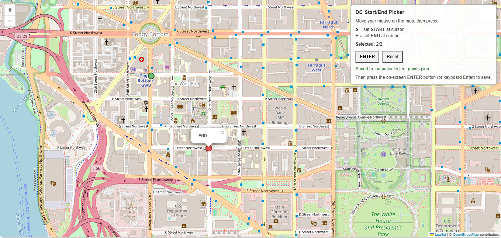
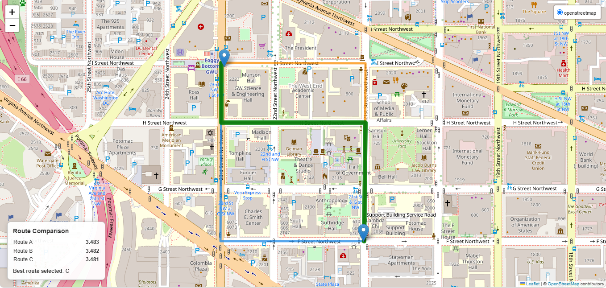

# Interactive OSM Route Planner

An interactive Python workflow for **selecting a start and destination on a map**, generating alternative routes from OpenStreetMap (OSM), and comparing those routes using an interpretable, map-derived complexity score. Developed as an academic prototype for transportation and autonomous/connected-vehicle research.

The project uses an in-browser point picker, OSMnx/NetworkX routing, and Folium visualizations. It reports a **relative heuristic score**, not a driving-safety assessment or a validated vehicle-control recommendation.

## Demonstration

### 1. Select START and END on the interactive map



With `dc_point_picker.py`, position the cursor on the map and press **S** for START and **E** for END. Press **Enter** (or use the on-screen button) to save the coordinates to [`output/selected_points.json`](output/selected_points.json).

### 2. Compare alternative routes



`route_planner.py` generates up to **K** candidate routes and highlights the lowest-scoring candidate in green. Other candidate routes may closely overlap, as shown above.

**Saved example results** (one run with the selected locations in Washington, DC):

| Route | Length (km) | Intersections/km | Sinuosity | Signals/km* | Crossings/km* | Complexity score |
|:--|--:|--:|--:|--:|--:|--:|
| A | 0.671 | 8.944 | 1.411 | 0.000 | 0.000 | 3.483 |
| B | 0.671 | 8.940 | 1.411 | 0.000 | 0.000 | 3.482 |
| C | 0.671 | 8.937 | 1.412 | 0.000 | 0.000 | **3.481** |

**Selected candidate: Route C**, based on the lowest saved heuristic score (3.481). The three scores are extremely close, so this is not evidence of a meaningful practical difference between the routes.

*The saved example reports **0** for traffic-signal and pedestrian-crossing density for every route. The source code uses zero when the separate OSM corridor-feature query fails; consequently, these zeros **must not be interpreted as verified absence of controls or crossings**. The comparison here is a demonstration of the workflow, not a fully validated four-factor ranking.*

**Generated artifacts:** [Interactive HTML comparison map](output/route_planning_map.html) · [Route summary (JSON)](output/routes_comparison.json) · [Detailed metrics (JSON)](output/routes_complexity.json).

The HTML file is a generated output. GitHub displays its source rather than an embedded interactive map; open the file locally in a web browser to interact with it. Map basemap tiles require a network connection.

## How the project works

1. **Point selection:** Choose START and END in the Washington, DC map interface; save their latitude/longitude coordinates to JSON.
2. **Road network:** Retrieve an OSMnx road graph covering those locations, or reuse suitable previously cached OSM data when available.
3. **Route alternatives:** Snap the locations to the network and generate up to K candidate paths with NetworkX's shortest-simple-paths algorithm, weighted by road length.
4. **Complexity evaluation:** Estimate intersection density, a sinuosity proxy, traffic-signal density, and crossing density along each candidate.
5. **Comparison and visualization:** Write JSON reports and a Folium HTML map showing the candidate routes and highlighting the lowest-scoring one.

### Complexity formula

The original score implemented in [`route_complexity.py`](route_complexity.py) is:

```text
Score = 0.35 × intersection_density
      + 0.25 × sinuosity
      + 0.20 × traffic_signal_density
      + 0.20 × crossing_density
```

These are fixed heuristic weights. The inputs have different units and are **not normalized to a common scale**, so interpret the result as an experimental within-project comparison rather than an objective measure of route difficulty. The candidate paths are length-based alternatives; the final choice minimizes the defined complexity score, not necessarily travel time or distance.

## Repository structure

```text
osm-interactive-route-planner/
├── dc_point_picker.py         # Browser-based START/END selection
├── route_planner.py           # Candidate routes, scoring, and map export
├── route_complexity.py        # Complexity formula and classification utilities
├── osm_route_analysis.py     # Shared road and corridor analysis functions
├── images/                   # Screenshots from an actual run
│   ├── point-selection.png
│   └── route-comparison.png
├── output/                   # Saved sample input and generated outputs
│   ├── selected_points.json
│   ├── route_planning_map.html
│   ├── routes_comparison.json
│   └── routes_complexity.json
├── static_dc_picker/         # Locally cached web interface assets
├── requirements.txt
├── LICENSE
└── README.md
```

## Installation and usage

Requires **Python 3.10 or later** and internet access for fresh OpenStreetMap queries and map tiles.

```bash
python -m venv .venv
```

Activate the environment in Windows PowerShell:

```powershell
.venv\Scripts\Activate.ps1
```

Or on macOS/Linux:

```bash
source .venv/bin/activate
```

Install dependencies:

```bash
python -m pip install -r requirements.txt
```

**Step 1 — Choose points**

```bash
python dc_point_picker.py
```

The application opens a local map interface in your browser. Hover over the desired locations and press **S**, then **E**, then **Enter** to save.

**Step 2 — Generate and compare routes**

```bash
python route_planner.py --k 3 --buffer-m 600 --output-dir output
```

This reads `output/selected_points.json` and writes the three output files linked above. The `--k` value controls the number of candidates; `--buffer-m` controls the size of the requested road-network area and can limit which route alternatives are available. Increase it when a larger search area is needed.

**Optional:** [`osm_route_analysis.py`](osm_route_analysis.py) contains a more comprehensive, separate road-attribute and corridor-analysis workflow. [`route_complexity.py`](route_complexity.py) also supports scoring previously generated analysis outputs.

## Limitations and reproducibility

- **Live-data dependency:** New route selections may trigger OpenStreetMap/Overpass downloads. Public servers can throttle, reject, or time out queries; the presence of saved example outputs does not guarantee every future request will complete.
- **Local cache:** `route_planner.py` can reuse OSMnx response files in an existing `cache/` directory when it finds a suitable connected network. That cache is deliberately **not included** in this repository; a fresh clone normally needs an online download. Cache reuse is a convenience and does not establish the freshness or suitability of the underlying road network for every trip.
- **Missing features:** If the corridor-feature query fails, the current implementation warns and substitutes zero signal/crossing counts. The saved example scores therefore require caution. The map-based prototype does not validate traffic control conditions or route safety.
- **Network and geometry:** Routes depend on available OSM data, snapping, geographic coverage and the graph produced by OSMnx; changing the buffer, map data, or software version may change the candidate paths.
- **Research status:** Heuristic route ranking is not a substitute for legal routing, real-time traffic information, or safety-critical driving decisions.

## License and data attribution

The project retains the original [MIT License](LICENSE) and its `Copyright (c) 2026 ava-share` notice. OpenStreetMap data and tile imagery are credited to © OpenStreetMap contributors. The web interface also uses third-party frontend libraries, including Leaflet; cached vendor assets remain subject to their respective licenses.
